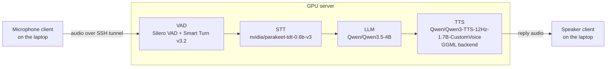

# Realtime Voice Agent: Measured, Documented and Run on a GPU Server

This project runs an open-source voice agent end to end on a remote GPU server. You speak into a microphone on your laptop. The server turns your speech into text, writes a reply with a language model, and speaks the reply back. I measured the pipeline, built a voice-turn dataset for later fine-tuning, wrote step-by-step guides, and made an interactive page that shows how one voice turn moves through the code.

## Demo

<!-- TODO: add video link -->
Video: coming soon.

## What I built

The voice pipeline code under `src/` is existing open-source code under the Apache-2.0 license. I did not change how it works. My work is this:

| Work | Files |
|---|---|
| A seven-stage plan (baseline, dataset, STT, LLM, TTS, inference, MLOps), with models, datasets, metrics and a done-check per stage | [docs/ROADMAP.md](docs/ROADMAP.md) |
| Stage 0 baseline: install, measure and record the pipeline. STT word error rate 1.82% on 100 LibriSpeech test-clean utterances. First-audio latency p50 2.89 s, p90 4.43 s on 40 Big Bench Audio questions (small LLM `Qwen/Qwen3.5-0.8B`). | [docs/stage0-baseline.md](docs/stage0-baseline.md), [docs/baselines.md](docs/baselines.md), [scripts/stage0_wer.py](scripts/stage0_wer.py) |
| Stage 1 dataset builder: fetch the MInDS-14 bank calls, write a reply per call, speak the reply, run quality checks, and split the data. 532 of 563 clips pass; split 424 / 55 / 53. | [scripts/stage1_dataset.py](scripts/stage1_dataset.py), [docs/stage1-walkthrough.md](docs/stage1-walkthrough.md) |
| Interactive flow page: animated, step-by-step views of every pipeline flow (startup, one voice turn, streaming, turn end, barge-in, run modes, chat history), with file:line links and a reader highlighter | [docs/flow.html](docs/flow.html) |
| Vietnamese version of the flow page | [docs/flow.vi.html](docs/flow.vi.html) |
| Run guide: run the server on a GPU server and talk to it from a Mac through an SSH tunnel. Measured first audio 3.26 s after warm-up. | [docs/RUN_ON_GPU_SERVER.md](docs/RUN_ON_GPU_SERVER.md) |
| WAV check client: send one WAV file to the Realtime server, save the spoken reply, and print the latency | [scripts/realtime_wav_check.py](scripts/realtime_wav_check.py) |

## Architecture

The pipeline is a cascade. Each stage runs in its own thread. Queues connect the stages. The server speaks the OpenAI Realtime protocol over WebSocket.



These are the pipeline defaults on Linux with CUDA. When the GPU has less than about 24 GB free, use the smaller LLM `Qwen/Qwen3.5-0.8B` (`--model_name Qwen/Qwen3.5-0.8B`).

## Quick start

Use Python 3.11.

1. Install the project from a clone:

   ```bash
   git clone https://github.com/Huy-Hieuu/realtime-voice-agent.git
   cd realtime-voice-agent
   python3.11 -m venv .venv
   source .venv/bin/activate
   pip install -e .
   ```

   The install gives you the `speech-to-speech` command.

2. Talk to the agent on one machine:

   ```bash
   speech-to-speech local
   ```

   Speak, then pause. The agent answers through your speakers. Stop with `Ctrl+C`. The first run downloads the models.

3. To run the server on a GPU server and the client on your laptop, follow [docs/RUN_ON_GPU_SERVER.md](docs/RUN_ON_GPU_SERVER.md).

4. To check a running server without a microphone:

   ```bash
   python scripts/realtime_wav_check.py question.wav --out reply.wav
   ```

For every server option, run `speech-to-speech serve -h`. For pipeline configuration files, read [docs/configuration.md](docs/configuration.md).

## License

Apache-2.0. See [LICENSE](LICENSE).
