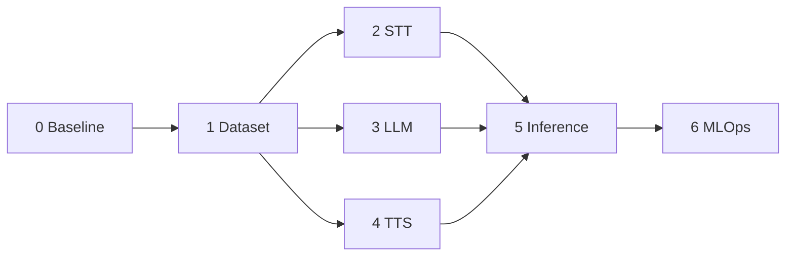

# Roadmap: build a speech-to-speech agent, stage by stage

Repository: this project builds on an open-source speech-to-speech pipeline (Apache-2.0, read at upstream commit `76818454`, version 1.1.0).
Machine: a shared Linux GPU server (one H100 MIG 7g.80gb slice, driver 550, 8 CPUs).
Writing rule: short sentences. `[INFERENCE]` = estimate, not measured. `[UNVERIFIED]` = not tested on this machine.
"Report P1-P12" = the projects of the AI-engineer learning-path report (2026-11-13, machine facts and day-by-day LLM/GPU projects). Use them as references for the stages below, not as a separate order.

The roadmap has seven stages. Stage 0 measures the upstream pipeline as it is. Stages 1-6 are the plan: data, STT, LLM, TTS, inference, MLOps.
Each stage replaces or improves one part of the pipeline and measures it against the Stage 0 numbers.



## The pipeline you build on

The upstream pipeline is a cascade: **VAD → STT → LLM → TTS**. Each part runs in its own thread. Queues connect them.
`speech-to-speech serve` serves it over the OpenAI Realtime protocol (WebSocket at `ws://127.0.0.1:8765/v1/realtime`). `speech-to-speech local` adds a microphone client.
To see one voice turn move through the threads and queues, open [flow.html](flow.html) in a browser (a static file; no server needed).
To run the server on a remote GPU server and talk to it from a Mac, follow [RUN_ON_GPU_SERVER.md](RUN_ON_GPU_SERVER.md).

| Part | Code (under `src/speech_to_speech/`) | Default | Select with |
|---|---|---|---|
| VAD | `VAD/vad_handler.py` (`VADHandler`), `VAD/vad_iterator.py` (Silero), `VAD/smart_turn.py` (`SmartTurnAnalyzer`, end-of-turn model) | Silero VAD + Smart Turn v3.2 | `--vad silero\|firered`, `--thresh`, `--min_silence_ms`, `--min_speech_ms`, `--no_smart_turn` |
| STT | `STT/parakeet_tdt_handler.py` (`ParakeetTDTSTTHandler`), `STT/whisper_stt_handler.py` (`WhisperSTTHandler`), `STT/faster_whisper_handler.py`, `STT/nemo_asr_handler.py`, `STT/qwen3_asr_handler.py`, `STT/openai_compatible_handler.py`, `STT/streaming_handler.py` | `parakeet-tdt` = [nvidia/parakeet-tdt-0.6b-v3](https://huggingface.co/nvidia/parakeet-tdt-0.6b-v3) | `--stt`, `--stt_model_name` (Whisper), `--language` |
| LLM | `LLM/language_model.py` (`LanguageModelHandler`, Transformers), `LLM/chat_completions_language_model.py` (`ChatCompletionsApiModelHandler`), `LLM/responses_api_language_model.py` (`ResponsesApiModelHandler`), `LLM/lm_output_processor.py` | `transformers` with [Qwen/Qwen3.5-4B](https://huggingface.co/Qwen/Qwen3.5-4B) (README: plan 24 GB VRAM) | `--llm_backend transformers\|chat-completions\|responses-api`, `--model_name`, `--responses_api_base_url`, `--responses_api_stream`, `--stream_batch_sentences`, `--init_chat_prompt` |
| TTS | `TTS/qwen3_tts_handler.py` (`Qwen3TTSHandler`), `TTS/kokoro_handler.py` (`KokoroTTSHandler`), `TTS/facebookmms_handler.py`, `TTS/openai_compatible_handler.py`, `TTS/pcm_blocks.py` | `qwen3` = [Qwen/Qwen3-TTS-12Hz-1.7B-CustomVoice](https://huggingface.co/Qwen/Qwen3-TTS-12Hz-1.7B-CustomVoice), GGML backend | `--tts`, `--qwen3_tts_model_name`, `--qwen3_tts_ref_audio`, `--qwen3_tts_ref_text`, `--qwen3_tts_backend ggml\|torch` |
| Wiring | `s2s_pipeline.py` (`build_pipeline`, `_build_handlers`), `backend_registry.py` (`STT_BACKENDS`, `LLM_BACKENDS`, `TTS_BACKENDS`), `baseHandler.py` (`BaseHandler`), `arguments_classes/` (every flag) | | `speech-to-speech serve -h` |
| Latency | `pipeline/turn_latency.py` (`TurnLatencyTracker`), [docs/response-latency.md](response-latency.md) | one log line per reply: `stt= llm= llm_first_tts= tts_ttfa= e2e=` | always on |
| System test | `evals/big_bench_audio/` ([docs/vibe-checks.md](vibe-checks.md)) | 40-question `vibe` sample of [Big Bench Audio](https://huggingface.co/datasets/ArtificialAnalysis/big_bench_audio) (MIT) | `python -m speech_to_speech.evals.big_bench_audio run --spawn --limit 4 --out <file> -- <server flags>` |
| Benchmarks | `scripts/benchmark_stt.py`, `scripts/benchmark_tts.py` | per-handler speed on one file / one text | `--handlers`, `--iterations` |

A fine-tuned model goes back into the pipeline through an existing flag. You do not need new handler code for Stages 2-4:
- STT: `--stt whisper --stt_model_name <your checkpoint dir or Hub id>`.
- LLM: `--model_name <your merged checkpoint>` (in process), or serve it with vLLM and use `--llm_backend chat-completions --responses_api_base_url http://127.0.0.1:8000/v1`.
- TTS: `--qwen3_tts_backend torch --qwen3_tts_model_name <your checkpoint>` [UNVERIFIED: a fine-tuned Base checkpoint through this handler], or `--tts openai` against your own `/v1/audio/speech` server ([docs/openai-compatible-tts.md](openai-compatible-tts.md)).

## Language: English first

Build every stage in **English** first. The upstream defaults do not cover Vietnamese: Parakeet TDT v3 covers 25 European languages, and the Qwen3-TTS handler maps only 10 languages (`QWEN3_LANGUAGE_ALIASES` in `TTS/qwen3_tts_handler.py`), so a Vietnamese build would replace two stages before you could measure anything.
Vietnamese is the **second pass** for Stage 2 (Whisper is multilingual) and Stage 4, after the English pipeline has numbers. The Vietnamese sets are listed per stage below.

## Machine facts and version pins

- **Driver 550.163.01 = CUDA 12.4.** CUDA 13 wheels do not run. torch ≥ 2.11, vLLM ≥ 0.20 and SGLang ≥ 0.5.11 on PyPI are CUDA 13.
- `pip install -e .` / `uv sync` accept `torch>=2.4.0` on Linux and pick the newest torch (CUDA 13). **Always pin torch in the same install command.**
- **The GPU is shared.** It is often full (0.2 GiB free at one check; 1.1 GiB free most of 2026-11-13). Run `gpufree` (defined in [stage0-baseline.md](stage0-baseline.md#every-session-start-here)) before every GPU step. If the GPU is busy, do the CPU work of the stage.
- **8 CPUs** (not the 224 that `nproc` shows). `/dev/shm` is 64 MiB: use DataLoader `num_workers=0`. No `nvcc`, `nsys` or `ncu`.
- Keep repos, envs, caches and data under `$HOME`.

| Stack | Pin | Why |
|---|---|---|
| Pipeline + training | `torch==2.9.1`, `torchaudio==2.9.1` (PyPI wheel = CUDA 12.8 runtime) | Newest torch on CUDA 12. CUDA 12.x minor-version compatibility runs it on driver 550 (torch 2.7.1+cu128 already runs on this GPU). |
| Qwen3-TTS GGML runtime | `qwentts-cpp-python==0.5.0+cu124` from the [prebuilt CUDA 12.4 wheel index](https://huggingface.co/datasets/andito/qwentts-cpp-python-wheels/tree/main/whl/cu124) | Built for CUDA 12.4 = the driver. The default PyPI wheel targets CUDA 12.8. [UNVERIFIED here] |
| Transformers | `transformers>=5.18,<6` | Upstream `pyproject.toml` requires it. |
| LLM serving (Stage 5) | `vllm==0.19.1` (separate env; pulls torch 2.10.0, CUDA 12.8) | Last vLLM on CUDA 12. [UNVERIFIED here] |
| LLM serving, option | `sglang==0.5.10` (torch 2.9.1, CUDA 12.8) | Last SGLang on CUDA 12. [UNVERIFIED here] |
| Stage 1 data env | `torch==2.9.1` CPU wheel (`uv pip install --torch-backend cpu`) | Stage 1 needs no GPU; the CPU wheel saves about 4 GB of CUDA libraries. Tested. |

Never run `pip install -U torch` in an env. Make a new env instead.

## Stage 0 - Baseline: run upstream unchanged

- **Goal:** Know what "good" is before you change anything. Run the upstream pipeline with its default models and measure it.
- **Walkthrough:** [stage0-baseline.md](stage0-baseline.md). You run it yourself, before Stage 1. It sets up `~/s2s`, `~/s2s-work` and the pinned env that later stages reuse.
- **Deliverable:** one row in [baselines.md](baselines.md): date, git SHA, models, GPU free at start, first-audio latency p50/p90, STT WER and sample count, notes.
- **Pipeline:** Silero VAD + Smart Turn → `parakeet-tdt` → `transformers` + `Qwen/Qwen3.5-4B` → `qwen3` (Qwen3-TTS 1.7B CustomVoice, GGML). These are the `speech-to-speech serve` defaults on Linux. If less than ~24 GB is free, keep everything else and record the swap: `--model_name Qwen/Qwen3.5-0.8B` ([model](https://huggingface.co/Qwen/Qwen3.5-0.8B)).
- **Install** (the env lives outside the repo, pins torch, uses the CUDA 12.4 TTS wheel; run it from `$S2S_WORK`, because the repo asks for a newer uv than the installed 0.12.16):
  ```bash
  uv venv --python 3.11 $S2S_WORK/envs/s2s
  uv pip install --python $S2S_WORK/envs/s2s/bin/python -e "$S2S" torch==2.9.1 torchaudio==2.9.1 jiwer pyarrow \
    "https://huggingface.co/datasets/andito/qwentts-cpp-python-wheels/resolve/main/whl/cu124/qwentts_cpp_python-0.5.0%2Bcu124-py3-none-manylinux_2_35_x86_64.whl"
  ```
- **Measure:**
  - First-audio latency: `python -m speech_to_speech.evals.big_bench_audio run --spawn --limit 40 --out $S2S_WORK/runs/s0/bba40.json -- --stt parakeet-tdt --tts qwen3`. This is the repo's own headless path: it starts `speech-to-speech serve` and streams 40 recorded questions over the Realtime WebSocket, so no microphone is needed. `ttfb` = end of the question audio → first reply audio. The report prints p50/p95; the walkthrough computes p90 from the JSON. The server log also prints `stt= llm= tts_ttfa= e2e=` per reply.
  - Quick WER: `scripts/stage0_wer.py` runs the pipeline's `ParakeetTDTSTTHandler` on the first 100 utterances of [LibriSpeech test-clean](https://huggingface.co/datasets/openslr/librispeech_asr) (CC BY 4.0, pinned revision) and scores them with `jiwer`. Normalization: lowercase, keep letters, digits and apostrophes. Stage 2 adds the MInDS-14 test split.
- **Done-check:** `docs/baselines.md` has a new row with every column filled from your own run, and the env lock hash in its notes.
- **Metrics:** first-audio latency p50/p90 (s), STT WER/CER (%), STT latency p50/p90 per utterance, Big Bench Audio accuracy, peak GPU memory.

## Stage 1 - Dataset engineering

- **Goal:** One dataset where every row is a full voice turn: user audio, transcript, intent, assistant response, and response audio. Quality-checked and split.
- **Deliverable:** `scripts/stage1_dataset.py` (fetch, respond, speak, check, split) and the walkthrough [stage1-walkthrough.md](stage1-walkthrough.md) (days 1-5). Data stays in `$S2S_WORK/data/minds14-en/` (not in git).
- **Dataset:** [PolyAI/minds14](https://huggingface.co/datasets/PolyAI/minds14) `en-US` (CC BY 4.0): 563 real phone calls to a bank, 14 intents (`balance`, `freeze`, `pay_bill`, ...), 8 kHz audio, 34 MB. It is the closest public match to a payments voice assistant. Add `en-GB` and `en-AU` for more data (same format).
- **Schema** (one JSON object per line in `manifest.jsonl`): `id`, `audio` (16 kHz mono WAV), `text` (transcript), `intent`, `duration`, `source_sr`, `response`, `response_model`, `response_audio` (24 kHz WAV), `response_voice`, `qc` (failed rules), `split`.
- **Response and output audio** are generated: [Qwen/Qwen2.5-0.5B-Instruct](https://huggingface.co/Qwen/Qwen2.5-0.5B-Instruct) (Apache-2.0) writes the reply on CPU; [hexgrad/Kokoro-82M](https://huggingface.co/hexgrad/Kokoro-82M) (Apache-2.0, the same model as the pipeline's `kokoro` backend) speaks it on CPU. They are silver labels: good enough to train and test the plumbing. Stage 3 improves the replies.
- **Quality checks:** audio readable, 16 kHz mono; 0.5-30 s; not silent (RMS ≥ -45 dBFS); not clipped (≤ 0.1% full-scale samples); transcript not empty; speech rate 0.5-5 words/s (catches transcript/audio mismatch); intent in the label set; no duplicate audio; reply present, ≤ 40 words, no markdown; reply audio readable, 24 kHz, 0.5-30 s.
- **Split:** 80/10/10 train/validation/test. Clips with the same normalized transcript stay in one split (no leakage). Each intent is spread over all splits. Seeded and deterministic.
- **Done-check:** `check` prints a pass count and a table of failures; `split` prints a split × intent table and `transcripts shared between train and validation/test: 0`. Measured on en-US: 532 of 563 clips pass; split 424 / 55 / 53; every intent has ≥ 3 clips in validation and test.
- **Metrics:** clean minutes per split, clips per intent, failure counts per rule.
- **GPU:** none. Stage 1 runs fully on CPU (measured: replies ~12 min, reply audio ~12 min for 563 clips on 8 CPUs).

## Stage 2 - STT modeling

- **Goal:** Fine-tune an ASR model on real audio and lower WER on your test split without hurting a general set.
- **Deliverable:** a fine-tuned checkpoint, its training script and config, and a results table. It runs in the pipeline with `--stt whisper --stt_model_name <checkpoint>`.
- **Models:** start with [openai/whisper-small](https://huggingface.co/openai/whisper-small) (Apache-2.0, 244M; trains on one GPU at ~10-20 GB [INFERENCE]). Then [openai/whisper-large-v3-turbo](https://huggingface.co/openai/whisper-large-v3-turbo) (MIT). Compare with the default [nvidia/parakeet-tdt-0.6b-v3](https://huggingface.co/nvidia/parakeet-tdt-0.6b-v3) (CC BY 4.0). Fine-tuning Parakeet needs NeMo (`pip install "speech-to-speech[nemo]"`; `nemo_toolkit` 3.0.0 on PyPI) [UNVERIFIED here].
- **Data:** MInDS-14 `train` split (8 kHz phone audio: a real domain shift); add `en-GB`/`en-AU`. General guard set: LibriSpeech `test-clean`. Vietnamese second pass: [google/fleurs](https://huggingface.co/datasets/google/fleurs) `vi_vn` (CC BY 4.0), [doof-ferb/vlsp2020_vinai_100h](https://huggingface.co/datasets/doof-ferb/vlsp2020_vinai_100h) (CC BY 4.0), [AILAB-VNUHCM/vivos](https://huggingface.co/datasets/AILAB-VNUHCM/vivos) (CC BY-NC-SA 4.0); baseline model [vinai/PhoWhisper-small](https://huggingface.co/vinai/PhoWhisper-small) (BSD-3-Clause).
- **Follow:** [Fine-Tune Whisper with Transformers](https://huggingface.co/blog/fine-tune-whisper) (Seq2SeqTrainer). The pipeline side: `STT/whisper_stt_handler.py` (`WhisperSTTHandler`; flags in `arguments_classes/whisper_stt_arguments.py`: `--stt_model_name`, `--stt_torch_dtype`, `--stt_compile_mode`, `--language`).
- **Done-check:** WER on MInDS-14 test drops versus the default Parakeet and the base Whisper on the same split; LibriSpeech test-clean WER (the Stage 0 set, `scripts/stage0_wer.py`) rises by less than 1 point absolute. `scripts/benchmark_stt.py --handlers whisper` shows the latency of the new checkpoint.
- **Metrics:** WER and CER (corpus level), RTFx, p50/p90 latency per utterance, peak GPU GB.
- **References:** report project P4 (fine-tuning habits) and P3 (profiling).

## Stage 3 - LLM modeling

- **Goal:** Fine-tune a small Qwen with LoRA/SFT so that replies are short, spoken-style and correct for the caller's intent. Measure response quality and multi-turn ability.
- **Deliverable:** a LoRA adapter and a merged checkpoint, the SFT script and config, an eval script with a fixed prompt set, and a results table. It runs with `--model_name <merged checkpoint>`.
- **Models:** [Qwen/Qwen2.5-1.5B-Instruct](https://huggingface.co/Qwen/Qwen2.5-1.5B-Instruct) (Apache-2.0) first: LoRA bf16 needs ~10-20 GB, QLoRA ~6-12 GB [INFERENCE]. Then the pipeline's own family, [Qwen/Qwen3.5-2B](https://huggingface.co/Qwen/Qwen3.5-2B) (Apache-2.0) [UNVERIFIED with PEFT/TRL here].
- **Data:** Stage 1 `train` rows as (system prompt, transcript) → response; rewrite weak replies with a bigger teacher first (report P5: distillation). Text intent data: [AmazonScience/massive](https://huggingface.co/datasets/AmazonScience/massive) (CC BY 4.0; en-US and vi-VN).
- **Follow:** [TRL SFTTrainer](https://huggingface.co/docs/trl/main/en/sft_trainer), [PEFT](https://github.com/huggingface/peft). The pipeline side: `LLM/language_model.py` (`LanguageModelHandler`), flags `--model_name`, `--init_chat_prompt`, `--chat_size`, `--llm_gen_max_new_tokens`, `--llm_gen_temperature`.
- **Done-check:** on the Stage 1 `test` split, the tuned model beats the base on intent-correct replies and on judged quality; ≥ 95% of replies are ≤ 30 words and have no markdown; a 5-turn scripted conversation keeps context (judged).
- **Metrics:** intent accuracy of the reply (a classifier or judge reads the reply), LLM-judge win rate versus the base (pairwise, fixed judge prompt and model), words per reply, markdown rate, tokens/s, time to first token.
- **References:** report P1 (GPT from scratch: what the model inside is), P4 (LoRA/QLoRA), P5 (distillation).

## Stage 4 - TTS modeling

- **Goal:** Fine-tune a TTS model on one speaker. Learn audio tokens, speaker conditioning (reference audio vs speaker fine-tune) and how to measure synthesis quality.
- **Deliverable:** a fine-tuned Qwen3-TTS checkpoint, the data-prep and training commands, and a listening and metrics table. Then re-generate Stage 1 `response_audio` with the new voice.
- **Models:** [Qwen/Qwen3-TTS-12Hz-0.6B-Base](https://huggingface.co/Qwen/Qwen3-TTS-12Hz-0.6B-Base) (Apache-2.0) first, then [1.7B-Base](https://huggingface.co/Qwen/Qwen3-TTS-12Hz-1.7B-Base). The upstream [QwenLM/Qwen3-TTS](https://github.com/QwenLM/Qwen3-TTS) repo (Apache-2.0) has `finetuning/prepare_data.py` and `finetuning/sft_12hz.py` (single-speaker SFT; input JSONL `audio`, `text`, `ref_audio`). CPU baseline: Kokoro-82M (Stage 1).
- **Data:** one speaker from [mythicinfinity/libritts_r](https://huggingface.co/datasets/mythicinfinity/libritts_r) (CC BY 4.0) or [CSTR-Edinburgh/vctk](https://huggingface.co/datasets/CSTR-Edinburgh/vctk) (CC BY 4.0). Vietnamese second pass: no Qwen3-TTS support; [facebook/mms-tts-vie](https://huggingface.co/facebook/mms-tts-vie) (CC BY-NC 4.0, non-commercial) runs in the pipeline as `--tts facebookMMS`.
- **Speaker conditioning without training:** `--qwen3_tts_model_name Qwen/Qwen3-TTS-12Hz-1.7B-Base --qwen3_tts_ref_audio <wav> --qwen3_tts_ref_text "<its transcript>"` (voice cloning; `--qwen3_tts_xvec_only` for x-vector only). Compare it with the fine-tuned voice.
- **Done-check:** the fine-tuned voice beats zero-shot cloning on speaker similarity at equal or better intelligibility; predicted MOS is within 0.2 of the base model; 20 blind A/B listens agree.
- **Metrics:** predicted MOS with [UTMOSv2](https://github.com/sarulab-speech/UTMOSv2) (MIT); speaker similarity = cosine of [speechbrain/spkrec-ecapa-voxceleb](https://huggingface.co/speechbrain/spkrec-ecapa-voxceleb) (Apache-2.0) embeddings, synthesis vs held-out real audio; intelligibility = WER of Whisper on the synthesized audio; RTF and time to first audio (`scripts/benchmark_tts.py`).

## Stage 5 - Inference engineering

- **Goal:** Lower first-audio latency of the whole pipeline. Stream every stage: streaming STT, token-by-token LLM, chunked TTS. Profile the GPU.
- **Deliverable:** a YAML pipeline config ([docs/configuration.md](configuration.md)) for your fastest setup, a latency table versus Stage 0, and one profile trace with notes.
- **Streaming STT:** live partial transcripts are on by default for Parakeet (`--enable_live_transcription`, `--live_transcription_update_interval`); true streaming models: `--stt nemotron-streaming` ([nvidia/nemotron-speech-streaming-en-0.6b](https://huggingface.co/nvidia/nemotron-speech-streaming-en-0.6b), NeMo extra) or `--stt vllm-realtime` ([docs/openai-compatible-stt.md](openai-compatible-stt.md)).
- **Token-by-token LLM:** serve the Stage 3 model with `vllm==0.19.1` (`vllm serve <model> --gpu-memory-utilization 0.15 --max-model-len 4096`), then `--llm_backend chat-completions --responses_api_base_url http://127.0.0.1:8000/v1 --responses_api_stream`. `--stream_batch_sentences 1` hands each sentence to TTS as soon as it ends (default 3).
- **Chunked TTS:** Qwen3-TTS streams PCM blocks (`TTS/pcm_blocks.py`); try `--qwen3_tts_non_streaming_mode false` (default `true` pre-fills the full text) and compare `tts_ttfa`.
- **Turn-taking:** tune `--min_silence_ms`, `--smart_turn_threshold`, `--speculative_reopen_ms`; each trades early replies against cut-offs.
- **Profiling:** `torch.profiler` traces of STT and TTS steps; Nsight Systems needs a user-space CUDA 12.4 toolkit install (report Day 10) [UNVERIFIED here].
- **Done-check:** Big Bench Audio `--limit 40` TTFB p50 is lower than Stage 0 at equal accuracy; the per-turn log shows which stage got faster.
- **Metrics:** first-audio latency (Big Bench Audio `ttfb p50/p95`, server `e2e`), per-stage `stt`, `llm_first_tts`, `tts_ttfa`, GPU memory, tokens/s.
- **References:** report P3 (profiling), P6 (vLLM serving, KV cache, batching), P7 (SGLang), P8 (quantization), P9 (speculative decoding), P10-P11 (Triton/CUDA kernels).

## Stage 6 - Production MLOps

- **Goal:** Make every result reproducible and every change safe: versioned data and models, tracked experiments, a registry, a deployment, monitoring and regression tests.
- **Deliverable:** in this repo: a regression test command and its thresholds, a deploy config, and a runbook; outside git: the registry and tracking store.
- **Dataset versioning:** push `minds14-en` (manifest + audio) to a private dataset repo on the Hub; pin each experiment to a commit hash (`revision=`). The manifest `id` never changes.
- **Experiment tracking:** one run record per training job: git SHA, data revision, env lock, config, metrics. [MLflow](https://mlflow.org/docs/latest/index.html) with a local file store needs no server.
- **Model registry:** private model repos on the Hub per stage (`stt-whisper-small-minds14`, ...) with a tag per release, or the MLflow registry. A release = model revision + eval report.
- **Deployment:** `speech-to-speech serve -f <config.yaml> --name <pipeline>`; `--num_pipelines` for concurrent sessions. The upstream `Dockerfile` and `docker-compose.yml` are the container start points.
- **Monitoring:** the per-turn latency log and `response.done` metadata (`speech_to_speech.turn_latency`, see [docs/response-latency.md](response-latency.md)); alert on e2e p95 and error status counts.
- **Regression testing:** on every model or code change, run: WER on the frozen Stage 1 test split; LLM eval on the frozen prompt set; TTS MOS/similarity on 50 fixed texts; `python -m speech_to_speech.evals.big_bench_audio compare <baseline.json> <candidate.json>`; and the upstream `uv run pytest tests -q`. Fail the change if a metric drops past its threshold.
- **Done-check:** one command re-runs the regression suite against a release and prints pass/fail per metric; a deliberately worse model fails it.

## Safety rules (every stage)

- Run `gpufree` before every GPU step. If free memory is less than the step needs, wait or do CPU work. `CUDA out of memory` at start usually means "busy".
- Always cap GPU memory: vLLM `--gpu-memory-utilization` (fraction of **total** memory; default 0.9 = ~71 GB), SGLang `--mem-fraction-static`. Stop servers when done.
- Keep everything under `$HOME`: `$S2S` (this repo), `$S2S_WORK` (envs, caches, data, runs). Keep your disk use under ~200 GB; the disk is shared.
- No private or employer code, data or credentials in this repo or in `$S2S_WORK`. Public datasets only, licence noted. No tokens in git.
- Run long jobs in `tmux`, so that a closed SSH session does not stop them.
